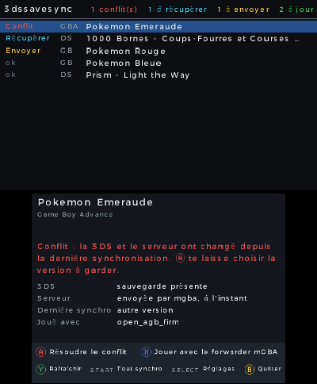
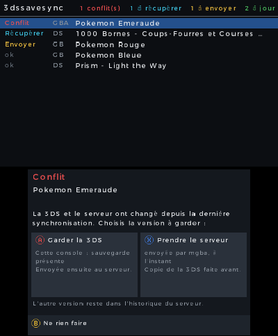

# 3dssavesync

Jouer à la même partie sur une 3DS modifiée et sur un émulateur PC, sans copier de fichier à la main. Couvre la **DS**, le **Game Boy / Game Boy Color**, la **GBA** et des jeux **3DS** natifs (par défaut les 8 Pokémon, de X à Ultra-Lune).

*[English version](README.md)*

- Un petit serveur garde **chaque version** de chaque sauvegarde et n'efface jamais rien.
- L'application 3DS et le Lanceur PC comparent des empreintes : si un seul côté a changé, la sauvegarde est copiée ; si les deux ont changé, vous choisissez (**jamais** d'écrasement automatique).
- Avant de remplacer une sauvegarde, une copie de sécurité est faite.
- Pour vous aider à choisir, chaque version affiche son temps de jeu et son dresseur (Pokémon, de Rouge/Bleu à Ultra-Lune) ou la date de son fichier (autres jeux).

| Application 3DS : liste des jeux et détails | Conflit : choisir la version à garder |
|---|---|
|  |  |

## Fonctionnement

```
       3DS (Luma3DS)                         Serveur                              PC
 ┌──────────────────────────┐      ┌────────────────────────────┐      ┌───────────────────────────┐
 │ application 3dssavesync  │ ───► │ serveur local dans le      │ ◄─── │ 3dssavesync (un seul      │
 │ (.cia)                   │ ◄─── │ programme PC, ou serveur   │ ───► │ programme) lancé par le   │
 │ · DS  (TWiLight Menu++)  │      │ personnel (Docker, HTTPS)  │      │ frontend ou un raccourci  │
 │ · GB  (TWiLight, mGBA)   │      │ garde chaque version       │      │ à la place de l'émulateur │
 │ · GBA (open_agb_firm,    │      │ pour toujours              │      │ synchro → partie → synchro│
 │        forwarders mGBA)  │      └────────────────────────────┘      └───────────────────────────┘
 │ · 3DS (archives)         │
 └──────────────────────────┘
```

Sur le PC, `3dssavesync` remplace l'émulateur dans votre frontend : il récupère la sauvegarde la plus récente, lance le jeu, attend la fermeture de l'émulateur, puis envoie la nouvelle sauvegarde. Sur la 3DS, l'application liste les jeux avec leur État (à jour, à envoyer, à récupérer, Conflit) ; START synchronise tout.

## Installation en 3 étapes

### 1. Le serveur

Choisissez ([guide du serveur](docs/guide-serveur.md)) :

| | Serveur local sur le PC | Serveur personnel (Docker) |
|---|---|---|
| Installation | rien de plus : l'étape 3 le configure | une machine toujours allumée (NAS, Raspberry Pi, serveur), Docker, un nom de domaine |
| Synchronisation | à la maison, PC allumé | partout (HTTPS) |

Serveur personnel : `server/docker-compose.yml` (derrière votre reverse proxy HTTPS) ou `server/docker-compose.caddy.yml` (HTTPS automatique avec Caddy). Image : `ghcr.io/programgames/3dssavesync-server`. La 3DS demande un certificat **Let's Encrypt** et TLS 1.2 avec ECDHE.

### 2. La 3DS

Prérequis : une 3DS avec un firmware modifié (Luma3DS) et FBI.

1. Téléchargez `3dssavesync.cia` dans la [dernière release](https://github.com/programgames/3dssavesync/releases/latest), copiez-le sur la carte SD, installez-le avec FBI.
2. Lancez **3dssavesync** : l'écran de réglages s'ouvre. Entrez l'adresse du serveur et le jeton, vérifiez les dossiers des ROM et des sauvegardes (ceux de TWiLight Menu++ sont proposés), puis **Tester la connexion**.

### 3. Le PC

1. Téléchargez le programme de votre système dans la [dernière release](https://github.com/programgames/3dssavesync/releases/latest) : `3dssavesync-windows-amd64.exe`, `-linux-amd64`, `-darwin-arm64`…
2. Double-cliquez dessus (Linux : `chmod +x`, puis `./3dssavesync-linux-amd64 setup` ; macOS : d'abord `xattr -d com.apple.quarantine <fichier>`, le programme n'est pas signé).
3. Une page de réglages s'ouvre dans le navigateur : serveur, émulateurs (trouvés automatiquement), LaunchBox, ES-DE, raccourcis. Cliquez sur **Enregistrer**.

Autres frontends (Steam ROM Manager, EmuDeck, RetroDECK, Playnite, RetroBat, Pegasus, Lutris, Attract-Mode) : [guide des frontends](docs/guide-frontends.md). Guide complet du PC : [docs/guide-client-pc.md](docs/guide-client-pc.md).

## Ce qui est géré

| | |
|---|---|
| **Sur la 3DS** | TWiLight Menu++ (DS, GB/GBC), open_agb_firm (GBA), forwarders mGBA (GB/GBC/GBA), jeux 3DS natifs (tout jeu dont la sauvegarde est un seul fichier `main` ; par défaut les 8 Pokémon) |
| **Émulateurs PC** | melonDS, mGBA, Azahar, RetroArch (cœurs melonDS DS, mGBA, Gambatte, SameBoy, VBA-M, gpSP et Beetle GBA convertis), VBA-M, SameBoy, DeSmuME (`.dsv`), et tout émulateur avec une ligne de commande personnalisée (sauvegardes brutes) |
| **Configuration automatique** | LaunchBox / BigBox, ES-DE, raccourcis (`.lnk`, `.desktop`, `.app`) |
| **Guides** | Steam ROM Manager, EmuDeck, RetroDECK, Playnite, RetroBat, Pegasus, Lutris, Attract-Mode |
| **Systèmes** | Windows, Linux, macOS (amd64 et arm64) |
| **Langues** | français, anglais (langue du système) |

**Testé sur du vrai matériel** : New 3DS XL (Luma3DS, TWiLight Menu++, open_agb_firm, forwarders mGBA), Windows 11 avec LaunchBox, melonDS, mGBA et Azahar, serveur personnel Docker.
**Pas encore testé sur un appareil** : Linux, macOS, Steam Deck (EmuDeck, RetroDECK, mode Jeu), RetroArch, VBA-M, SameBoy, DeSmuME, ES-DE, la 3DS avec le serveur local. Les retours sont bienvenus.

## Pièges connus

- **Savestates** : charger un état remplace la sauvegarde par une ancienne. mGBA recharge un état au lancement par défaut (`autoload`) ; le Lanceur avertit après une Récupération si ce réglage (ou celui de RetroArch, VBA-M) est actif.
- **Sauvegarde vierge** (que des `0x00` ou `0xFF`) : comptée comme absente, jamais envoyée.
- **Horloge d'Or / Argent / Cristal** : chaque machine garde sa propre horloge ([ADR 0008](docs/adr/0008-gb-gba-par-fichiers-sram-seule.md)).
- **Pas encore géré** : DeSmuME (`.dsv`), NO$GBA, gpSP, Beetle GBA (formats à convertir), jeux GBA à EEPROM, jeux GB MBC2.

## Comment la synchronisation décide

Pas de dates (l'horloge de la 3DS n'est pas fiable) : chaque machine compare trois empreintes SHA-256, la sienne, celle du serveur et celle de la dernière synchronisation (la **Base**). Un seul côté a changé : on copie. Les deux : **Conflit**, vous choisissez. Chaque jeu a une **Clé** lue dans la ROM, identique sur la 3DS et le PC : code jeu DS (`ADAF`), `GBA-BPEF`, `GB-PM_CRYSTAL-F2E2` (titre + somme de contrôle), `3DS-00040000001B5000` (title ID). Détails : [docs/design.md](docs/design.md), [ADR](docs/adr/), [GLOSSARY](docs/GLOSSARY.md).

## Développement

```bash
cd server && python -m unittest test_server.py      # contrat HTTP (aussi : NDSSYNC_URL=https://... contre un serveur déployé)
cd client && go test ./...                           # Lanceur PC, contre le vrai serveur (Python requis)
cd 3ds && make cia                                   # devkitPro, makerom et bannertool dans le PATH
```

Tests C (gcc sur le PC) : voir `.github/workflows/ci.yml`. GitHub Actions lance tous les tests (Go sous Windows, Linux et macOS) et compile le `.cia` / `.3dsx` ; un tag `v*` publie une release avec les programmes PC et l'image du serveur. L'ancien Lanceur PowerShell (`pc/sync.ps1`) reste disponible.

Recherches : [v1](docs/research.md), [v2](docs/research-v2.md), [v3](docs/v3-plan.md).

## Licence

MIT.
