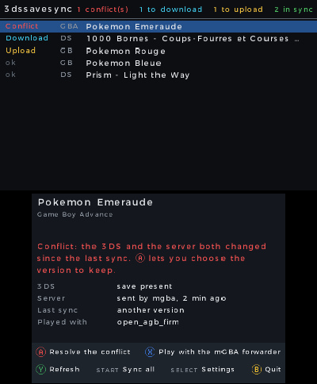
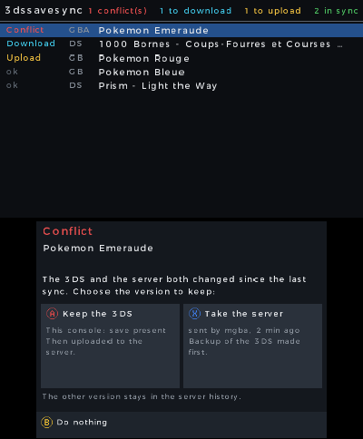
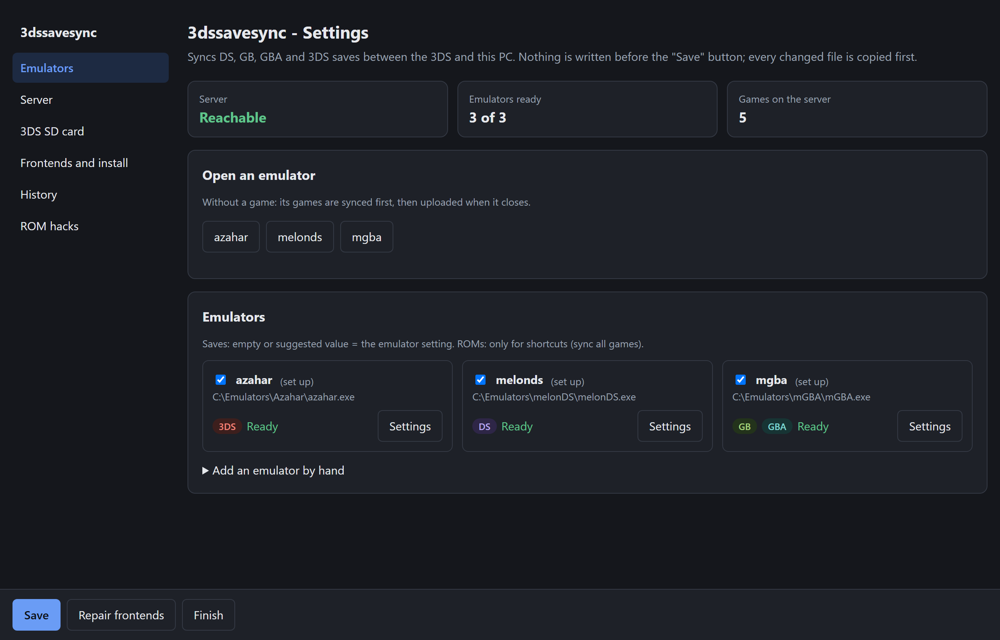

# 3dssavesync

[](https://github.com/programgames/3dssavesync/releases/latest)
[](https://github.com/programgames/3dssavesync/releases)
[](https://github.com/programgames/3dssavesync/actions/workflows/ci.yml)
[](LICENSE)

**3dssavesync keeps the saves of your DS, Game Boy, Game Boy Color, GBA and 3DS games the same on a modded 3DS, the emulators of your PC and an Android phone, through a server at home or your own.**

*[Version française (résumé)](README.fr.md)*

| On the 3DS: your games and their state | When both sides changed: you choose |
|---|---|
|  |  |

**On the PC: one settings page** (server status, emulators, history, ROM hacks)



## Features

- **Three kinds of devices**: a 3DS app (Luma3DS), a PC program for Windows, Linux and macOS, and an Android app (first version).
- **DS, Game Boy, Game Boy Color, GBA and 3DS games.** Every native 3DS game with a save syncs, and Game Boy and Game Boy Color Virtual Console games too. You can turn a 3DS game off on each device.
- **On the 3DS**: TWiLight Menu++, open_agb_firm and mGBA forwarders. Open the app and press START: every game is synced.
- **On the PC**: melonDS, mGBA, Azahar, RetroArch and [more](#supported). Your game starts as usual from LaunchBox, ES-DE or a shortcut: 3dssavesync gets the newest save first, then sends it back when you quit.
- **Frontends set up for you**: LaunchBox / BigBox, ES-DE and desktop shortcuts. Guides for Steam ROM Manager, EmuDeck, RetroDECK, Playnite and others.
- **Every version is kept** on the server. Restore an old one from the PC settings page or the Android app.
- **Conflicts**: when both sides changed, you choose. Each version shows its date, and for the Pokémon games its play time and trainer name.
- **A backup copy before every replace**: each device copies a save before it writes over it.
- **ROM hacks** (Radical Red and others) can get their own save, apart from the original game.
- **Portable version**: everything in one folder, for example on a USB drive or a Steam Deck.
- **English and French**, chosen from the system language.
- **Updates**: each app checks GitHub once a day, installs only when you click **Update**, and checks the file against the SHA-256 of the release first.
- **Your server, your saves**: a local server built into the PC program, or your own Docker server with HTTPS. No account, no cloud service.

> [!IMPORTANT]
> **Good practice**
> - Keep your own backups too, for example with Checkpoint or JKSM on the 3DS.
> - Sync before and after you play: open 3dssavesync on the 3DS before you start a game, and again when you stop.
> - Use the same version of a game (the same update) on every device.
> - Take care after you reinstall a 3DS game or format the SD card. The 3DS app then asks before a new save replaces the one on the server ([ADR 0027](docs/adr/0027-jeu-3ds-reinstalle.md)): keep the server save if you want your old progress.

Requires a modded 3DS (Luma3DS).

## Quick start

### 3DS and PC, at home

About 10 minutes. Do the PC first: it prepares the 3DS for you.

1. **Download the PC program and start it.**

   | System | File |
   |---|---|
   | Windows | [3dssavesync-windows-amd64.exe](https://github.com/programgames/3dssavesync/releases/latest/download/3dssavesync-windows-amd64.exe) |
   | Windows on ARM | [3dssavesync-windows-arm64.exe](https://github.com/programgames/3dssavesync/releases/latest/download/3dssavesync-windows-arm64.exe) |
   | Linux | [3dssavesync-linux-amd64](https://github.com/programgames/3dssavesync/releases/latest/download/3dssavesync-linux-amd64) · [arm64](https://github.com/programgames/3dssavesync/releases/latest/download/3dssavesync-linux-arm64) |
   | macOS (Apple silicon) | [3dssavesync-darwin-arm64](https://github.com/programgames/3dssavesync/releases/latest/download/3dssavesync-darwin-arm64) |
   | macOS (Intel) | [3dssavesync-darwin-amd64](https://github.com/programgames/3dssavesync/releases/latest/download/3dssavesync-darwin-amd64) |

   - **Windows**: double-click it. If Windows shows "Windows protected your PC", [here's what to do](docs/troubleshooting.md#windows-protected-your-pc).
   - **macOS**: the program is not signed. In a terminal, run `xattr -d com.apple.quarantine <file>` once, then double-click it.
   - **Linux**: run `chmod +x 3dssavesync-linux-amd64`, then `./3dssavesync-linux-amd64 setup`.
2. **Follow the 4 steps of the settings page** that opens in your browser. On **Server**, keep **Local server on this PC** (the default). On **Emulators and frontends**, check the emulators it found and your frontends, then click **Save and continue**. If Windows asks about the firewall, allow **private networks**: otherwise the 3DS can't reach the PC.
3. **Prepare the 3DS.** Put the 3DS SD card in the PC and click **Prepare the 3DS SD card**: it writes the server address and token, and copies `3dssavesync.cia` to the `cias` folder. Put the card back in the 3DS. Open FBI and go to **SD** > **cias** > **3dssavesync.cia** > **Install and delete CIA**. No FBI? Get [FBI.3dsx](https://github.com/nh-server/FBI-NH/releases/latest), copy it to the `3ds` folder of the card and open it from the Homebrew Launcher. No SD card reader? See the [PC guide](docs/guide-pc.md#the-settings-page).
4. **Check that it works.** Start **3dssavesync** from the HOME Menu: it connects to the PC on its own and lists your games. Press **START** to sync them all. On the PC, start one of these games from your frontend or from the **3dssavesync &lt;emulator&gt;** shortcut: you pick up where you left off. Save, quit, then open 3dssavesync on the 3DS: the game shows **Download**. Press **A** to get your save.

On **Everything is ready**, the settings page shows ✓ on each line, or what's left to do. Something does not work? Read [Troubleshooting](docs/troubleshooting.md).

### Two 3DS consoles

Set up the PC once (steps 1 and 2), then do steps 3 and 4 for each console: **Prepare the 3DS SD card** writes the same server and token to each card. Both consoles then sync the same saves. Sync on one console before you play on the other, or you get a conflict ([FAQ](docs/faq.md#can-i-use-two-3ds-consoles)).

### 3DS and Android

1. Set up the PC and the 3DS first: the phone uses the same server.
2. Install `3dssavesync-android.apk` from the [latest release](https://github.com/programgames/3dssavesync/releases/latest).
3. On the PC settings page, open **Server** and click **Show the QR code**. In the app, tap **Scan the PC's QR code**, then choose your emulator and its folders.

The Android app is a first version and not tested on many phones yet: start with a copy of one save. See the [Android guide](docs/guide-android.md).

### Sync away from home

The local server works only on your home network, while the PC is on. To sync from anywhere, run your own server on an always-on machine (NAS, Raspberry Pi) with Docker and HTTPS. The 3DS trusts a Let's Encrypt certificate, or your own CA if you add it to the SD card. Then choose **Personal server** on the PC settings page and prepare the 3DS SD card again. See the [server guide](docs/guide-server.md).

**Portable version** (everything in one folder: `LaunchBox\ThirdParty\3dssavesync`, a USB drive, the SD card of a Steam Deck): see the [PC guide](docs/guide-pc.md#portable-version).

## Everyday use

- **PC**: start your games from your frontend or the shortcuts, as before. Your save is uploaded when you close the emulator.
- **3DS**: open 3dssavesync before and after you play. Press **START** to sync everything, or **A** on one game.
- **Conflict** (you played on both sides): you choose which save to keep. The other one stays in the server history or in a backup copy.
- **Get back an old version**: open the **3dssavesync settings** shortcut, go to **Games**, pick the game and the version, and click **Restore this version** (or run `3dssavesync restore`). Each device gets it at its next sync, after a backup.
- **No network after a game on the PC**: the save stays on the PC and is uploaded the next time you start any game.
- **Icon near the clock** (Windows, Linux KDE): right-click it to open the settings, upload pending saves now or see the local server address. More in the [PC guide](docs/guide-pc.md#the-icon-near-the-clock).
- **Updates**: the settings page and the icon near the clock tell you when a new version is out. Click **Update** on the settings page and the program updates and restarts itself. For the 3DS app, update it from its settings (**SELECT** > **Update**), or prepare the SD card again. More in the [PC guide](docs/guide-pc.md#updates).

- **ROM hacks** (Radical Red and others) use the same game code as the original. 3dssavesync won't mix them up and offers to give the hack [its own save](docs/troubleshooting.md#a-rom-hack-is-not-synced).
- **ROMs in subfolders** on the 3DS are found, up to 4 levels deep. Each save goes where your 3DS app expects it.
- **More PC settings** (emulators, frontends, commands): [PC guide](docs/guide-pc.md). **3DS settings**: [3DS guide](docs/guide-3ds.md).
- **Questions and ideas**: read the [FAQ](docs/faq.md), or ask in [Discussions](https://github.com/programgames/3dssavesync/discussions).

## Supported

| | |
|---|---|
| **3DS apps** | TWiLight Menu++ (DS, GB/GBC), open_agb_firm (GBA), mGBA forwarders (GB/GBC/GBA), Game Boy and Game Boy Color Virtual Console games, native 3DS games: every game with a save ([details](docs/guide-3ds.md#native-3ds-games)) |
| **PC emulators** | melonDS, mGBA, Azahar, RetroArch (cores melonDS DS, mGBA, Gambatte, SameBoy, VBA-M, gpSP, Beetle GBA), VBA-M, SameBoy, DeSmuME, SkyEmu, NanoBoyAdvance, BGB, and any emulator with a custom command line |
| **Android emulators** (first version) | RetroArch, Azahar (3DS), melonDS, NooDS, and other emulators by folder: [Android guide](docs/guide-android.md) |
| **Set up automatically** | LaunchBox / BigBox, ES-DE, desktop shortcuts |
| **Guides** | [Steam ROM Manager, EmuDeck, RetroDECK, Playnite, RetroBat, Pegasus, Lutris, Attract-Mode](docs/guide-frontends.md); [HOME menu icons (forwarders)](docs/guide-forwarders.md) |
| **PC systems** | Windows, Linux, macOS (amd64 and arm64) |
| **Languages** | English, French (follows the system language) |

Native 3DS games: the 8 Pokémon games (X to Ultra Moon) sync their raw `main` file, as before. Every other game syncs all the files of its save as one archive. Super Mario Maker is never synced.

**Tested on real hardware**: New 3DS XL (Luma3DS, TWiLight Menu++, open_agb_firm, mGBA forwarders) with the local server and with a Docker server; Windows 11 with LaunchBox, melonDS, mGBA and Azahar.
**Not tested on a device yet**: Linux, macOS, Steam Deck (EmuDeck, RetroDECK, Game mode), RetroArch, VBA-M, SameBoy, DeSmuME, SkyEmu, NanoBoyAdvance, BGB, ES-DE, the Android app. Reports are welcome.

## Limits and good to know

- **No background sync on the 3DS.** The 3DS app syncs only while it is open, when you press **START** or **A**.
- **PC**: a game syncs when it starts through 3dssavesync and when its emulator closes. With the [icon near the clock](docs/guide-pc.md#the-icon-near-the-clock) (Windows, Linux), the PC also syncs when you close an emulator you opened yourself, and every 15 minutes. macOS has no icon yet.
- **Android**: the app syncs when you open it and tap **Sync all**, or a game's action. It can upload in the background (off by default), but it never downloads in the background ([Android guide](docs/guide-android.md#background-upload)).
- **The local server on the PC works only on your home network**, while the PC is on. To sync from anywhere, run [your own server](docs/guide-server.md).
- **Large 3DS saves**: on the 3DS, a 3DS game save larger than 16 MB, or with a file path longer than 100 characters, stays **Not synced**, with the reason under the game.
- **Games never synced**: Super Mario Maker (its save works only on the console that made it), the games you turned off, and Virtual Console games with restore points.
- **Save states**: loading a state brings back an older save. mGBA reloads a state at start by default (`autoload`). 3dssavesync warns you when this setting (or the one of RetroArch or VBA-M) is on.
- **Blank save** (only `0x00` or `0xFF`): counted as no save, never sent.
- **Gold / Silver / Crystal clock**: each machine keeps its own clock. The game progress is the same.
- **GBA EEPROM and GB MBC2 saves** are converted between emulators ([ADR 0012](docs/adr/0012-eeprom-et-mbc2-forme-du-serveur.md)). An EEPROM save sent from open_agb_firm before v3.5 is in the wrong byte order on the server: send it again from the 3DS first, then get it on the PC.
- **Not supported**: NO$GBA, Panda3DS.

## Your data

| Where | What |
|---|---|
| PC: `%APPDATA%\3dssavesync` (Windows), `~/.config/3dssavesync` (Linux), `~/Library/Application Support/3dssavesync` (macOS) | `config.json`, the log `3dssavesync.log`, backup copies in `copies/`, local server data in `serveur/` |
| 3DS: `sdmc:/3ds/3dssavesync/` | `config.ini` (server, token, folders), `titres-off.ini` (3DS games turned off), the journal `journal.log`, backup copies in `copies/` |
| Android: the app's own storage | settings and token (private to the app), backup copies in `Android/data/io.github.programgames.savesync/files/copies/` |
| Server: `data/<game key>/` | every version of every save, never deleted |

With the local server, nothing leaves your home network. Your saves stay in your emulator and 3DS app folders, as before.

## Uninstall

1. Close LaunchBox and ES-DE.
2. Open **3dssavesync settings**, part **Frontends and install**, then click **Uninstall 3dssavesync**.
3. On the 3DS, open FBI, **Titles**, **3dssavesync**, **Delete Title**.

LaunchBox and ES-DE get their original emulators back, so your games start as before. The shortcuts and the program go to the Recycle Bin (portable version: the program stays; delete its folder yourself). Your saves do not move; the settings, the backup copies and the local server data stay, and the report says where. Without the settings page: `3dssavesync uninstall`.

## How it works

```
   3DS (Luma3DS)                Server                         PC
 3dssavesync app   <--->  local server in the PC  <--->  3dssavesync, started by your
 (DS, GB, GBA, 3DS)       program, or Docker server      frontend instead of the emulator:
                          keeps every version            sync -> play -> sync
```

No dates: the 3DS clock is not reliable. Each machine compares three fingerprints of the save: its own, the server's, and the one from its last sync. Only one side changed: the save is copied. Both changed: you choose. Each game has a key read from the ROM, the same on the 3DS and the PC, so file names do not matter.

All documentation: [docs/](docs/README.md). Design and decisions: [design](docs/design.md), [ADRs](docs/adr/), [glossary](docs/GLOSSARY.md).

## Development

```bash
cd server && python -m unittest test_server.py      # HTTP contract (also: NDSSYNC_URL=https://... against a deployed server)
cd client && go test ./...                           # PC program, against the real server (Python needed)
cd 3ds && make cia                                   # devkitPro, makerom and bannertool in PATH
```

C tests (gcc on the PC): see `.github/workflows/ci.yml`. GitHub Actions runs every test (Go on Windows, Linux and macOS) and builds the `.cia`. A `v*` tag publishes a release with the PC programs and the server image.

The apps speak English and French. Most code identifiers and comments are still French and are being moved to English. See [CONTRIBUTING.md](CONTRIBUTING.md) for the build steps, the rules every change follows, and how AI tools are used here. Release notes: [CHANGELOG.md](CHANGELOG.md).

## Roadmap

Planned:

- A listing on Universal Updater, later.

Ideas, if the need shows up:

- One token per device, so that a lost device can be blocked without a new token on the others.
- A server command that moves old versions to a quarantine folder, to free disk space. Nothing would be deleted: you would empty that folder yourself.

Set aside (not planned): GBA Virtual Console saves; a public hosted server.

Ideas are welcome in [Discussions](https://github.com/programgames/3dssavesync/discussions).

## Credits

- The 3DS app is built with [devkitPro](https://devkitpro.org/) (devkitARM, libctru, citro2d) and its portlibs [curl](https://curl.se/) and [mbedTLS](https://www.trustedfirmware.org/projects/mbed-tls/) for HTTPS.
- 3dssavesync syncs the saves of [TWiLight Menu++](https://github.com/DS-Homebrew/TWiLightMenu), [open_agb_firm](https://github.com/profi200/open_agb_firm), [mGBA](https://mgba.io/) and [Azahar](https://azahar-emu.org/), and of the other emulators listed in [Supported](#supported).
- [Checkpoint](https://github.com/BernardoGiordano/Checkpoint) inspired the way the 3DS app reads and writes save archives.
- [DaeMoon](https://github.com/mirusu400/DaeMoon) showed the 3DS network setup (curl with mbedTLS, the embedded root certificate) and how to read the game code in a ROM.
- [cloudpoint](https://github.com/dwalker109/cloudpoint) gave ideas for whole-archive 3DS saves, reinstalled games and this README.

## License

MIT.
