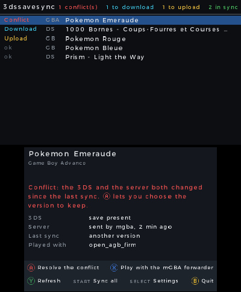

# 3DS guide

The 3dssavesync app lists your games with their state, and syncs them with the server.

## Buttons

| Button | Action |
|---|---|
| Up / Down | choose a game |
| **A** | the action of the game: upload, download, or resolve the conflict |
| **X** | GB and GBA games: switch the save between the mGBA forwarder and the ROM ([forwarder guide](guide-forwarders.md#switch-program-for-a-game-x-button-in-3dssavesync)) |
| **Y** | read the server again |
| **START** | sync all games. Conflicts and duplicates are skipped. One confirmation lists the downloads that replace a 3DS save. |
| **SELECT** | settings |
| **B** | quit |

You can also touch the buttons on the bottom screen.

## Game states

| State | Meaning |
|---|---|
| In sync | the 3DS and the server have the same save |
| To upload | the 3DS save is newer: **A** uploads it to the server |
| To download | the server save is newer: **A** downloads it, after a backup |
| Conflict | both changed since the last sync: **A** lets you choose (A keeps the 3DS save, X uses the server save, B does nothing) |
| Duplicate | two ROMs give the same game: keep one, or [give the hack its own save](troubleshooting.md#a-rom-hack-is-not-synced) |
| Unknown | the server could not be read: press **Y** |

The top of the list counts the games in each state (counters that do not fit are left out, "in sync" first). The bottom line shows the server, when it was read, and your place in the list. The bottom screen shows the details of the chosen game, and the message of the last action in a band above the buttons: a red line on its left means a failure, green a success.

## Settings (SELECT)

| Line | Default | Meaning |
|---|---|---|
| Server | — | address of the server, for example `http://192.168.1.20:8765` (local server) or `https://saves.example.com` |
| Token | — | the token of the server |
| DS ROMs | `sdmc:/roms/nds` | DS ROM folder (TWiLight Menu++) |
| DS saves | `sdmc:/roms/nds/saves` | TWiLight Menu++ default. Empty = next to the ROM. |
| GB ROMs | `sdmc:/roms/gb` | GB and GBC ROM folder (TWiLight Menu++) |
| GB saves | empty | empty = next to the ROM (TWiLight Menu++). The mGBA forwarder save wins if it exists. |
| GBA ROMs | `sdmc:/roms/gba` | GBA ROM folder |
| GBA saves | empty | empty = next to the ROM (open_agb_firm with `useSavesFolder=false`). With `useSavesFolder=true`: `sdmc:/3ds/open_agb_firm/saves`. |
| 3DS games | the 8 Pokémon games | native 3DS games to sync. Only games with a single save file can be ticked. |
| Connection | | **Not tested**, **OK** or the reason of the failure. **A** tests the address and the token. |
| Version | | the installed version and its state, for example `3.7.0 · Up to date` or `3.7.0 · 3.7.1 available`. **A** checks for a new version, then offers to install it ([Updates](#updates)). |

A setting left empty shows its default in grey (**Next to the ROM**). **Server** and **Token** show **Required** while they are empty. The action of **A** is written on the right of the chosen line.

The PC fills in **Server** and **Token** when you prepare the SD card from its settings page. The other lines keep their value.

## ROMs in subfolders

3dssavesync reads the ROM folders and their subfolders, up to 4 levels deep. It skips folders named `saves`, `3ds`, `luma`, `mGBA`, `Nintendo 3DS`, and folders that start with `.` or `_` (such as `_nds`).

The save of a ROM in a subfolder is where your 3DS app writes it:

| Save setting | Save of `<roms>/<subfolder>/X.nds` |
|---|---|
| `<roms>/saves` (TWiLight Menu++ default) | `<roms>/<subfolder>/saves/X.sav` |
| empty, or the ROM folder | `<roms>/<subfolder>/X.sav` |
| another folder | `<saves>/X.sav` |

3dssavesync reads 512 games at most.

## Files on the SD card

All in `sdmc:/3ds/3dssavesync/`:

| File | Content |
|---|---|
| `config.ini` | server, token, folders |
| `base.ini` | the last synced state of each game. Do not delete it: without it, every changed game shows a conflict. |
| `titres.ini` | the 3DS games to sync (absent = the 8 Pokémon games) |
| `alias.ini` | optional: ROM hacks with their own save, written by the PC (settings page, Prepare the 3DS SD card): `Pokemon Radical Red=GBA-0A7K` ([details](troubleshooting.md#a-rom-hack-is-not-synced)) |
| `maj.ini` | the day of the last update check, the latest version seen on GitHub, and the version that ran last (read by the PC: it does not copy an older `.cia` to the card) |
| `copies/` | backup copies made before a save is replaced |

## Updates

Once a day, when the app starts, it asks GitHub for the latest version. This takes a few seconds. If a newer version exists, the bottom screen shows:

> Version 3.7.0 available (SELECT) *(Version 3.7.0 disponible (SELECT))*

To install it:

1. Press **SELECT**.
2. Choose the **Version** line, and press **A** (**Update**). The app asks GitHub again.
3. Read the question, and press **A** (**Update**) to accept, or **B** to cancel.
4. Wait. The app downloads the new version, checks it, then installs it.
5. Press **A** to close the app. Start it again from the HOME Menu (`.cia`) or from the Homebrew Launcher (`.3dsx`).

Nothing is installed without your choice. The update does not touch your saves, your settings, or `base.ini`.

- The installed `.cia` is replaced by the new `.cia`. If you started the `.3dsx` from the Homebrew Launcher, that `.3dsx` file is replaced instead (the old one is kept as `.bak` until the new one is in place). Started with 3dslink, the app does not update itself.
- Before it installs, the app compares the SHA-256 of the downloaded file with the `SHA256SUMS` file of the same GitHub release. If they differ, nothing is installed.
- If something fails, the old version stays. The **Version** line of the settings shows what happened, what to do, and a code: see [Troubleshooting](troubleshooting.md#update-messages).
- No network, or GitHub does not answer: the app works as before. It tries again the next day, or when you press **A** on **Version**.
- A version built from the source code (`dev`) never offers an update.

You can always install a version by hand: download `3dssavesync.cia` from the [releases page](https://github.com/programgames/3dssavesync/releases), and install it with FBI.

## Native 3DS games

Open **SELECT** > **3DS games** to tick the games to sync. Only a game with a single save file can be synced. A game that is not in the list: start it once and save.

On the PC, add the same games to `titres_3ds` in `config.json` ([PC guide](guide-pc.md#configuration)).

## Virtual Console games (Game Boy, Game Boy Color)

Game Boy and Game Boy Color games bought on the eShop show up by themselves in the **GB** tab, marked **GB VC**. There is nothing to tick. They need Luma3DS: the app reads the game's ROM to know which game it is, so that the save goes to the same place as the cartridge ROM on your PC or in mGBA.

- A Virtual Console game and the mGBA forwarder (or TWiLight Menu++ ROM) of the same game are two separate lines, and both are synced. Play the one you like: after a **Sync all**, the other one gets your progress. If you play both without syncing in between, you get a conflict and choose which one to keep.
- A Virtual Console game you never started has no save yet. Press **A** on it to create its save from the server version. **Sync all** leaves these games alone, so it never fills games you don't play.
- Gold, Silver and Crystal: each copy keeps its own clock, so the time of day in the game can change when you switch.
- A game with restore points stays **Not synced**: a restore point could bring an older game back over the synced one.
- The **Key** line under the game shows which game it is. If the ROM can't be read, the game stays **Not synced**, with the step that failed, and nothing is changed.

Something does not work? See [Troubleshooting](troubleshooting.md#3ds).
