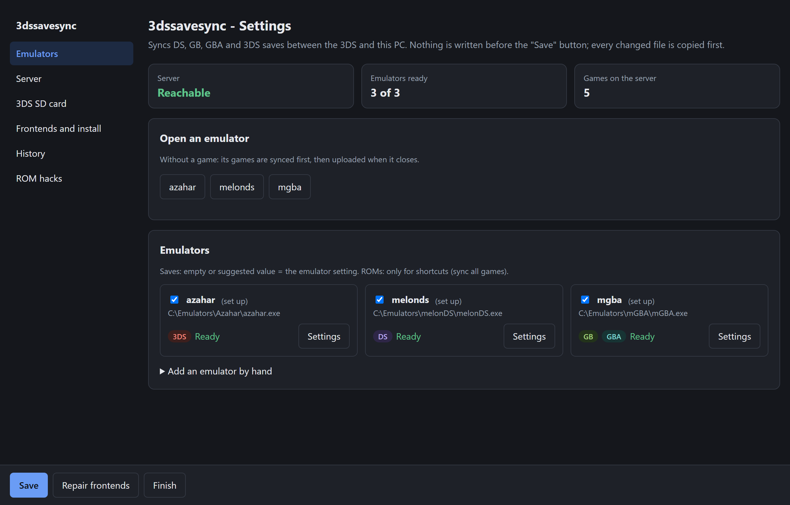

# PC guide

`3dssavesync` is one program, with nothing else to install. On Windows, it opens no console window during your games. It syncs the saves before the game, starts the emulator, waits until it closes, then syncs again.

## The settings page

Double-click the program, or the **3dssavesync settings** shortcut. A settings page opens in your browser. Its address is local (`http://127.0.0.1:<port>/<secret>/`): only this PC can open it.



At the top, three boxes show the state at a glance: server reachable or not, emulators ready, games on the server. The menu on the left opens one part at a time; an orange dot marks a part to check. The parts:

1. **Server**: **Local server on this PC** (the default) or **Personal server** (address and token, button **Test the connection**). See the [server guide](guide-server.md).
2. **3DS SD card** (after the server is saved): put the 3DS SD card in the PC and click **Prepare the 3DS SD card**. The address and token go into `3ds/3dssavesync/config.ini` on the card. The old file is copied first, and its other settings are kept. No card reader? **Download config.ini** and copy it by FTP to `sdmc:/3ds/3dssavesync/`.
3. **Program**: copies the program to a fixed place, so that frontends and shortcuts always find it: `%LOCALAPPDATA%\Programs\3dssavesync` (Windows), `~/.local/bin` (Linux), `~/Applications/3dssavesync` (macOS).
4. **Emulators**: one card per emulator of your settings or found on the PC (PATH, usual folders, Flatpak, EmuDeck AppImages, `/Applications`, LaunchBox emulators), with its consoles and its state. **Settings** opens its save and ROM folders. **Add an emulator by hand** adds another one.
5. **Frontends and shortcuts**: LaunchBox (Windows), ES-DE, one shortcut per emulator that has a ROM folder (**3dssavesync &lt;emulator&gt;**), the **3dssavesync settings** shortcut, and **Show the icon near the clock** (see [The icon near the clock](#the-icon-near-the-clock)).
6. **History**: search a game, then get back an old version of its save (see [Restore an old version](#restore-an-old-version)).
7. **ROM hacks**: give a hack its own save (see [ROM hacks](#rom-hacks)).
8. **Uninstall** (part Frontends and install): gives LaunchBox and ES-DE their original emulators back, then moves the shortcuts and the program to the Recycle Bin. See [ADR 0019](adr/0019-desinstallation.md).

Nothing is written before you click **Save**. A personal server that does not answer blocks the save. Every file that changes (`config.json`, frontend files) is copied first, with the date in its name. The token is never shown, except the address and token of the local server, in the box "To enter on the 3DS". The program stops when you click **Finish**, or 2 minutes after you close the tab.

No browser (SSH, Steam Deck in Game mode): `3dssavesync setup --sans-navigateur` prints the address of the page, and `3dssavesync setup --texte` asks the same questions in the terminal.

**Repair frontends**: after a frontend update or reset (EmuDeck rewrites the ES-DE files), close the frontend, open **3dssavesync settings** and click **Repair frontends**. What is already in place does not change. Same in a terminal: `3dssavesync repair`.

Frontends to set up by hand (Steam ROM Manager, EmuDeck, RetroDECK, Playnite, RetroBat, Pegasus, Lutris, Attract-Mode): [frontend guide](guide-frontends.md).

## The icon near the clock

A 3dssavesync icon sits near the clock (Windows notification area, Linux system tray). It starts with your session. Right-click it:

- **Open settings**: opens the settings page. On Windows, a double-click on the icon does the same; on Linux, a left click.
- **Send now (N pending)**: only when uploads are pending (see [Pending uploads](#pending-uploads)). It sends them now, then a notification gives the result.
- **Local server: running (http://…)**: with the local server, the address to enter on the 3DS, or the error when the server stopped. The icon program runs the local server itself: one program stays in memory, not two.
- **Quit**: removes the icon until the next session. The local server stops with it.

To remove the icon, untick **Show the icon near the clock** in the part **Frontends and install**, then click **Save**. The local server then starts alone with the session (`3dssavesync serve`), as before version 3.7. Each **Save** restarts the icon with the new settings. The uninstall stops it first, so that the program can go to the Recycle Bin.

- **Windows**: the icon can hide behind the arrow `^` of the taskbar. Drag it next to the clock to keep it visible.
- **Linux**: KDE Plasma (Steam Deck in Desktop mode) shows it. GNOME shows it only with the extension **AppIndicator and KStatusNotifierItem Support** ([help](troubleshooting.md#the-icon-near-the-clock-does-not-show)).
- **macOS**: no icon yet. Use the **3dssavesync settings** shortcut.

Command: `3dssavesync tray`. A second one stops at once, without a message. See [ADR 0022](adr/0022-icone-pres-de-l-horloge.md).

## Configuration

The settings page writes `config.json` in the settings folder:

- Windows: `%APPDATA%\3dssavesync\config.json`
- Linux: `~/.config/3dssavesync/config.json`
- macOS: `~/Library/Application Support/3dssavesync/config.json`

Another place: option `--config <file>`. Example: [`client/config.example.json`](../client/config.example.json). The field names are French.

| Field | Meaning |
|---|---|
| `url`, `jeton` | The server address and its token. |
| `copies` | Folder of the backup copies (optional; default: `copies` next to `config.json`). |
| `serveur_local` | Optional: `{"port": 8765, "donnees": "…"}` for `3dssavesync serve`; `url` is then `http://127.0.0.1:<port>`. See the [server guide](guide-server.md). |
| `icone_horloge` | `false` only when the icon near the clock is turned off. Absent: the icon is shown. |
| `titres_3ds` | Optional: 3DS games to sync in addition to the 8 Pokémon games, `{"<title ID>": "<name>"}`. Same list as the **3DS games** screen of the 3DS. Only games with a single save file `main`. |
| `alias` | Optional: `{"<ROM file name without extension>": "<key>"}`, for a ROM hack that keeps the key of its original game. See [ROM hacks](#rom-hacks). |
| `emulateurs.<name>.exe` | The emulator executable. |
| `emulateurs.<name>.profil` | Optional: the profile (table below). Default: the name of the entry. Useful for two installs of the same emulator. |
| `emulateurs.<name>.sauvegardes` | Optional: system → save folder (`DS`, `GB`, `GBA`; `3DS`: the `sdmc` folder). Default: the emulator setting. When present, the emulator handles only these systems. |
| `emulateurs.<name>.coeurs` | RetroArch only: system → core file. |
| `emulateurs.<name>.roms` | System → ROM folder. Only for the `launch` command (shortcuts). |
| `emulateurs.<name>.processus` | Optional: name of the process to wait for. Default: the executable name. Useful for a Flatpak started by a script. |

Each entry of `emulateurs` syncs on its own: it has its own sync state (`bases/<name>.json`). The log is `3dssavesync.log`, next to `config.json`.

## Profiles

Without `sauvegardes`, 3dssavesync reads the save folder from the emulator settings. It looks for the settings file next to the executable (portable install), then in the usual places of Windows, Linux (Flatpak and RetroDECK included) and macOS. Without a setting, the save is next to the ROM.

| Profile | Systems | Folder read from | Save file | State reloaded at start |
|---|---|---|---|---|
| `melonds` | DS | `melonDS.toml`: `SaveFilePath` | `<ROM>.sav`; ROM in a zip: name of the file inside | — |
| `mgba` | GB, GBA | `config.ini`: `savegamePath` | `<ROM or zip>.sav` | `autoload` (on by default) |
| `azahar` | 3DS | `qt-config.ini`: `sdmc_directory`, else `user/sdmc` | `sdmc/Nintendo 3DS/…/main` | — |
| `retroarch` | the ones of `coeurs` | `retroarch.cfg`: `savefile_directory` and the sort options | `<ROM or zip>.srm` | `savestate_auto_load` |
| `vbam` | GB, GBA | `vbam.ini`: `BatteryDir` | `<ROM or zip>.sav` | `AutoLoadLastState` |
| `sameboy` | GB | (always next to the ROM) | `<ROM>.sav` | — |
| `desmume` | DS | Windows: `desmume.ini` next to the exe, `[PathSettings]` `Battery` (default `Battery` next to the exe); Linux: `~/.config/desmume` | `<ROM>.dsv`; ROM in a zip: name of the file inside | — |
| `skyemu` | DS, GB, GBA | next to the ROM; else "Save File/State Path" (`search_paths.bin`) if the `.sav` is already there or "Create new files in paths" is ticked | `<ROM or zip>.sav` | — (state written automatically, restored only by hand) |
| `nanoboyadvance` | GBA | `config.toml` next to the exe (macOS: `~/Library/Application Support/org.github.fleroviux.NanoBoyAdvance/`): `[general]` `save_folder`, if present | `<ROM or zip>.sav` | — |
| `bgb` | GB | (next to the ROM) | `<ROM>.sav` | — |

**DeSmuME**: the `.dsv` file holds the save, then a footer of 122 bytes. 3dssavesync removes the footer before it compares and uploads: the server gets the same raw save as the 3DS. On a download, it makes the backup copy, then puts back the footer of the existing `.dsv` (same size) or writes a new one, as DeSmuME does when it imports a `.sav`. A `.dsv` without a valid footer is not synced. macOS: folder not checked, set `sauvegardes`.

**SkyEmu, NanoBoyAdvance, BGB**: the save is raw. BGB adds a 48-byte clock trailer for GB games with a clock: 3dssavesync keeps it on the PC, as for mGBA. With NanoBoyAdvance, leave the extra arguments empty: the ROM must be the first argument. If you fill in "Save files" (Misc tab) in BGB, set the same folder in `sauvegardes`: 3dssavesync does not read this setting (undocumented `bgb.ini` key). BGB under Wine: `exe` = `wine`, `args_en_plus` = the path of `bgb.exe`, set `processus` (not tested).

**RetroArch cores**: melonDS DS, mGBA, Gambatte, SameBoy, VBA-M, gpSP, Beetle GBA. The `.rtc` file (clock of GB games) stays on the PC. Example:

```json
"retroarch": {
  "exe": "C:\\RetroArch\\retroarch.exe",
  "coeurs": {
    "DS": "C:\\RetroArch\\cores\\melondsds_libretro.dll",
    "GB": "C:\\RetroArch\\cores\\gambatte_libretro.dll",
    "GBA": "C:\\RetroArch\\cores\\mgba_libretro.dll"
  }
}
```

**gpSP and Beetle GBA**: these cores write a `.srm` file of fixed size (128 KiB for gpSP, 136 KiB for Beetle GBA), whatever the game. 3dssavesync uploads only the save data, at the size of the server version: it compares the same way as mGBA or the 3DS. It refuses to sync if the `.srm` has data outside this size, or if the server does not have this game yet: sync the game first from mGBA or the 3DS. On a download, it makes the backup copy, then writes a full `.srm`. Beetle GBA: keep the option `gba_use_mednafen_save_method` at `libretro` (default). Details: [ADR 0011](adr/0011-srm-gpsp-beetle-taille-du-serveur.md).

**GBA EEPROM and GB MBC2**: these saves have a different file in each emulator. 3dssavesync converts them, so that the 3DS and every PC emulator see the same save ([ADR 0012](adr/0012-eeprom-et-mbc2-forme-du-serveur.md)). Backup copies always keep the original bytes.

**State reloaded at start**: an emulator that reloads a save state can replace a version that just came from the server with an older game. After a download, 3dssavesync asks **Play anyway** or **Don't play**, and names the setting to change. Without a download, it only writes a warning in the log.

### Custom profile

In the settings page, click **Add an emulator by hand**, then choose **Other emulator (custom)**. Fill in: name, executable, command line with `{rom}` and `{sauvegardes}`, systems, save folder of each system (required), save extension. The page shows the resulting command with an example ROM. In `config.json`, it is an entry with `args` (argument template) and `sauvegardes`:

```json
"myemulator": {
  "exe": "C:\\Emu\\emu.exe",
  "args": ["--battery-dir={sauvegardes}", "{rom}"],
  "sauvegardes": { "GBA": "C:\\Emu\\saves" },
  "extension": ".sav",
  "nom_interne": false
}
```

`{rom}` is the ROM (removed by `launch`, which starts the emulator without a game). `{sauvegardes}` is the save folder of the system. `nom_interne`: `true` if the emulator names the save after the file inside the zip, not after the zip. The save must be raw (a GB/GBA clock trailer is handled).

**Extra arguments** (built-in profile): field **Extra arguments (before the ROM)** of the page, or `args_en_plus` in `config.json` (for example `["-f"]` for full screen). They come just before the ROM. The profile's own arguments (`-C savegamePath=…` for mGBA, `-L <core>` for RetroArch) stay managed by 3dssavesync.

**Panda3DS**: not supported. Its only release (v0.9) reads and writes save files at a wrong position: 3dssavesync could upload a wrong 3DS save.

**No save after the game**: if a game has no save before the game and still none after, a notification gives the expected file. If you saved in the game, the folder or the extension of the emulator is wrong.

## Commands

```
3dssavesync run [--emulator <name>] <rom>
3dssavesync run [--emulator <name>] --rom <rom> -- <command…>
3dssavesync launch <name>
3dssavesync migrate-v2 <sync.ps1 folder>
3dssavesync setup [--texte] [--sans-navigateur]   (or no argument)
3dssavesync repair
3dssavesync serve             (local server, see guide-server.md)
3dssavesync tray              (icon near the clock, and the local server)
3dssavesync restore [--oui] [<key> [<number>]]
```

- **`run <rom>`**: one game. For frontends (LaunchBox, Playnite, ES-DE…). `--emulator` is required only when two emulators handle the same system.
- **`run --rom <rom> -- <command>`**: syncs the ROM, then runs the given command as is. For frontends that go through their own launcher (RetroBat) or a command prefix (Lutris).
- **`launch <name>`**: without a frontend. Syncs all games of the emulator (the ROMs of its `roms` folders, and the 3DS Pokémon games, even if never started in Azahar), starts the emulator without a game, then syncs everything when it closes. This is what the **3dssavesync &lt;emulator&gt;** shortcuts do. mGBA gets its save folder only if GB and GBA share the same folder.
- **`restore`**: see [Restore an old version](#restore-an-old-version).
- **`migrate-v2`**: takes over `sync.config.json` and `base.json` of the old PowerShell launcher. Nothing is replaced: the command refuses if the configuration already exists. The v2 install is not changed.

A frontend that stops the program during the game (stop signal on Linux and macOS) does not prevent the upload: the program waits for the emulator to end. A forced stop (`SIGKILL`, "End task") cuts the upload; it goes out at the next launch.

## Pending uploads

The upload after a game failed (network cut, server off)? The save is written in `en-attente.json`, next to `config.json`. At the start of the next `run` or `launch`, whatever the game, 3dssavesync syncs it first, with the usual comparison. A conflict asks the usual question (**Keep the PC** or **Do nothing**). Nothing is ever overwritten without a comparison. The save stays pending while its emulator is open or the server does not answer.

## Restore an old version

The server keeps every version of every save. To make an old version the current one again:

1. Open **3dssavesync settings**, part **History**.
2. Choose the game. The page lists its last 30 versions: date, device, size, and play time and trainer for a Pokémon game.
3. Click **Restore this version**, then confirm.

In a terminal: `3dssavesync restore` lists the games of the server and their key. `3dssavesync restore <key>` lists the last 30 versions, with a number. `3dssavesync restore <key> <number>` restores that version after a confirmation (`--oui`: no question). On Windows, the command opens its own console, like `repair`.

Nothing is written on the PC. Each device gets the version at its next sync, after a backup copy. A device with a game not yet uploaded shows a conflict, and you choose. If an upload arrives between the list and the restore, the restore is refused and nothing is overwritten: show the list again. Details: [ADR 0016](adr/0016-restauration-depuis-le-pc-sans-ecriture-locale.md).

## ROM hacks

A ROM hack often keeps the game key of its original game (Pokémon Radical Red keeps the one of Fire Red). So that the two games never mix ([ADR 0014](adr/0014-rom-hack-et-alias.md)):

- `run`: 3dssavesync remembers the ROM of each synced game. Another ROM with the same key asks a question: **Sync separately (ROM hack)** gives the hack its own save; **Play without sync** starts it without sync. If the remembered ROM no longer exists (renamed, moved), the new one takes its place.
- `launch`: two ROMs with the same key in the `roms` folders are not synced; a notification names them.

To give a hack its own save before its first start, open **3dssavesync settings**, section **ROM hacks**, choose the ROM file, then click **Add**. The list shows the hacks with their own save; **Remove** puts a hack back under the key of its original game.

Then, for the 3DS, click **Prepare the 3DS SD card** again: it writes `sdmc:/3ds/3dssavesync/alias.ini`, so the 3DS gives the hack the same key as the PC. Keep the same ROM file name on the PC and on the SD card.

Behind the scenes, each hack gets an alias in `config.json` (`"alias": {"<ROM file name without extension>": "<key>"}`): a key of the ROM system that starts with a digit, such as `GBA-0A7K` (`0A7K` for DS, `GB-ALIAS-1F3C` for GB). No commercial game has such a key. The same ROM file name gives the same key on every PC.

## LaunchBox

The settings page adds, for each emulator, a **new** emulator "<title> (3dssavesync)", copied from the original emulator:

- application path = 3dssavesync; parameters per platform = `run --emulator <name>` (LaunchBox adds the ROM at the end);
- "hide console" unticked; archive extraction unticked for DS, GB and GBA (3dssavesync reads `.zip` files), kept for 3DS;
- it becomes the default emulator of its DS, GB, GBA and 3DS platforms.

The original emulator stays intact: to play without sync, choose it in LaunchBox. To go back, make it the default again. LaunchBox and BigBox must be closed (they rewrite `Emulators.xml` when they close). Copy before any change: `Data\Emulators.xml.avant-3dssavesync-<date>`.

An emulator already changed by hand to go through 3dssavesync is recognized: no duplicate is created.

## ES-DE

In `ES-DE/custom_systems` (the ES-DE or EmuDeck folder):

- `es_find_rules.xml`: emulator `3DSSAVESYNC` = the installed program;
- `es_systems.xml`: a command "3dssavesync (<name>)" first in the systems `nds`, `gb`, `gbc`, `gba`, `n3ds` (the first command is the default one). A system missing from the file gets a minimal block with only this command; to get the other ES-DE emulators back, remove this block.

ES-DE must be closed.

## Windows and messages

- **Conflict**: three buttons before the game (**Take the server**, **Keep the PC**, **Don't play**), two after (**Keep the PC**, **Do nothing**). Closing the window = the last button, the safest.
- **State reloaded at start**, after a download: **Play anyway**, **Don't play**.
- **Information** (emulator already running, upload failed): a notification, nothing to confirm.
- **Two games at the same time** (a trade between Pokémon X and Y, for example): possible when both are started by 3dssavesync. Each one takes a lock (`en-cours` in the settings folder). Refused only if the same game already runs, or if the emulator was opened outside 3dssavesync (its game is then unknown). The same game twice (X and X) needs a second copy of the emulator, with its own save folder.
- **Tools**: Windows: native window and notification. macOS: `osascript` (part of the system). Linux: `zenity` or `kdialog` (the KDE one first under KDE), notifications with `notify-send`.
- **No window possible** (no tool, no display, for example over SSH): a conflict replaces nothing, the game uses the PC save, and the message goes to a notification and to the error output.
- **Language**: French if the system is in French, else English (Windows: interface language; Linux and macOS: `LANGUAGE`, `LC_ALL`, `LC_MESSAGES`, `LANG`, then the macOS language). The log stays in French.
- **Not tested on a device yet**: Linux, macOS, Steam Deck in Game mode (Gamescope).

Something does not work? See [Troubleshooting](troubleshooting.md).
